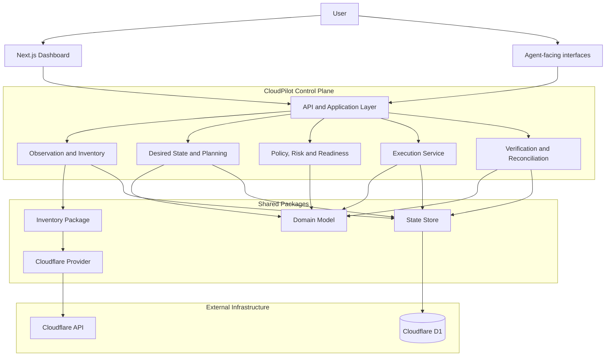

# CloudPilot

**A policy-governed infrastructure control plane for planning, evaluating, executing, and verifying infrastructure changes.**

CloudPilot explores a problem that becomes increasingly important as infrastructure operations are automated: how do we let software propose infrastructure changes without giving those proposals unrestricted authority to execute?

Generating an API request or deployment script is relatively straightforward. The harder engineering problems are deciding whether a change is permitted, determining what it affects, controlling how it executes, persisting what happened, and checking whether the resulting infrastructure actually matches the intended state.

CloudPilot addresses these problems through a control-plane architecture built around explicit desired state, provider observations, policy evaluation, controlled execution, and post-execution verification.

The current implementation targets **Cloudflare infrastructure**, with a deliberately limited execution surface.

## Architecture

CloudPilot is organized as a TypeScript monorepo. Its responsibilities are separated into domain logic, infrastructure inventory, provider integration, persistence, the control-plane application, and a dashboard.



### Repository structure

```text
cloudpilot/
├── apps/
│   ├── control-plane/          # Cloudflare Worker application and API
│   └── dashboard/              # Next.js management dashboard
│
├── packages/
│   ├── domain/                 # Infrastructure domain and decision logic
│   ├── inventory/              # Provider-backed infrastructure inspection
│   ├── cloudflare-provider/    # Cloudflare API integration and execution
│   └── state-store/            # Persistence interfaces and adapters
│
├── docs/                       # Architecture and engineering documentation
├── package.json
├── pnpm-workspace.yaml
└── pnpm-lock.yaml
```

## How it works

CloudPilot separates the decision to make a change from the act of making it.

### 1. Observe infrastructure

The inventory layer retrieves supported infrastructure resources from Cloudflare.

Observations are persisted so that planning and the dashboard can work with a known, saved view of infrastructure state.

### 2. Define desired state

A desired-state document describes the resource configuration CloudPilot should maintain.

The control plane validates the document before using it in planning, evaluation, or execution.

### 3. Generate a plan

The planning layer compares desired state with observed state and produces explicit operations.

Plans represent the changes required to move from the observed configuration toward the desired configuration. Resource scope and Worker script drift are considered during planning.

### 4. Evaluate before execution

Each operation passes through evaluation stages:

- **Policy:** Is the operation permitted?
- **Risk:** What is the operation's risk classification?
- **Approval:** Does the operation require approval?
- **Execution capability:** Does the configured provider support this operation?
- **Readiness:** Is the operation ready, blocked, or awaiting approval?

An operation being proposed does not make it executable.

### 5. Execute permitted operations

The execution service receives evaluated operations and delegates supported infrastructure operations to the provider adapter.

The current Cloudflare execution implementation supports Worker create, update, and delete operations. Unsupported resource operations are rejected during evaluation rather than being passed to an executor that cannot safely perform them.

### 6. Verify the resulting state

A successful deployment request is not treated as proof that the desired state was achieved.

CloudPilot obtains a fresh observation and compares the resulting configuration with desired state. For existing Workers, it also checks deployed script content.

Verification reports whether the modeled configuration matches the desired state, differs from it, or could not be verified.

This is configuration and deployment verification—not a test of application runtime health.

## Implemented capabilities

| Area                     | Current capability                                                                                   |
| ------------------------ | ---------------------------------------------------------------------------------------------------- |
| Infrastructure inventory | Cloudflare account, zones, DNS records, and Workers                                                  |
| Desired state            | Validated desired-state documents and persistence                                                    |
| Planning                 | Desired-versus-observed comparison and operation generation                                          |
| Resource scope           | Persisted management scope used during planning                                                      |
| Policy                   | Allow/deny decisions for planned operations                                                          |
| Risk                     | Operation risk classification                                                                        |
| Approval evaluation      | Identifies operations requiring approval                                                             |
| Capability evaluation    | Blocks unsupported provider operations                                                               |
| Worker execution         | Create, update, and delete                                                                           |
| Execution persistence    | Execution status, summaries, and verification results                                                |
| Verification             | Fresh configuration observation and Worker script comparison                                         |
| Reconciliation           | Evaluate drift and coordinate permitted corrective operations                                        |
| Dashboard                | Infrastructure overview, desired-state editing, plan review, policy summaries, and execution history |
| Agent interfaces         | MCP and natural-language proposal integration                                                        |

### Provider execution support

CloudPilot distinguishes between resources it can inspect and operations it can execute.

| Resource               | Inspection |              Execution |
| ---------------------- | ---------: | ---------------------: |
| Cloudflare Workers     |  Supported | Create, update, delete |
| Cloudflare Zones       |  Supported |          Not supported |
| Cloudflare DNS records |  Supported |          Not supported |

Unsupported operations are blocked during evaluation. This capability boundary is intentional: a provider should not silently accept an operation simply because the domain model can represent it.

## Engineering design principles

**Separate proposals from authority**

Natural-language or agent-generated proposals do not directly authorize infrastructure changes. The control plane remains responsible for validation, policy, risk, capability, and readiness decisions.

**Make operations explicit**

Infrastructure changes are represented as structured operations rather than arbitrary scripts passed directly to an execution environment.

**Keep provider-specific behavior at the boundary**

The domain layer contains infrastructure decision logic. Cloudflare API behavior is isolated in the provider package.

**Treat failures as first-class outcomes**

Execution records preserve status and available summaries or verification information when an operation fails. Provider responses and incomplete pagination metadata are validated instead of being treated as trustworthy by default.

**Verify outcomes independently**

CloudPilot compares the resulting observed configuration with desired state rather than assuming that a successful API response proves convergence.

## Technology stack

| Technology         | Responsibility                                      |
| ------------------ | --------------------------------------------------- |
| TypeScript         | Application, domain, and provider implementation    |
| pnpm workspaces    | Monorepo and package management                     |
| Cloudflare Workers | Control-plane runtime                               |
| Cloudflare D1      | Persistent state                                    |
| Cloudflare API     | Infrastructure inspection and Worker operations     |
| Next.js and React  | Dashboard                                           |
| MCP                | Agent-facing infrastructure tool interface          |
| Groq               | Natural-language proposal generation                |
| Vitest             | Unit and application-level testing                  |
| Wrangler           | Local Cloudflare development and deployment tooling |

## Getting started

### Prerequisites

- Node.js 22 or later
- pnpm 11
- A Cloudflare account for provider-backed functionality
- Cloudflare Workers and D1 configuration for the control plane

### Install dependencies

```bash
pnpm install
```

### Configure the control plane

Configure the Cloudflare Worker and D1 bindings using the control-plane Wrangler configuration.

Provide required local credentials and environment variables through the appropriate local configuration files. Do not commit credentials, API tokens, or secret values.

The control plane uses separate API and MCP bearer-token boundaries. Agent proposal functionality also requires its configured model-provider credentials.

### Run locally

Start the control plane:

```bash
pnpm --filter cloudpilot-control-plane dev
```

Start the dashboard in a separate terminal:

```bash
pnpm --filter dashboard dev
```

The dashboard requires its control-plane URL and API token to be configured server-side.

### Run checks

From the repository root:

```bash
pnpm test
pnpm typecheck
pnpm lint
pnpm build
```

The dashboard has its own test and production-build commands:

```bash
pnpm --filter dashboard test
pnpm --filter dashboard build
```

The control-plane build script uses Wrangler's deployment dry-run.

## Current limitations

CloudPilot is an engineering prototype, not a production-ready infrastructure management platform.

- **Provider scope:** The current provider implementation targets Cloudflare.
- **Execution scope:** Worker operations are supported; Zone and DNS record mutations are not.
- **Approval lifecycle:** Approval requirements are evaluated, but a complete human approval and authorization lifecycle is not implemented.
- **Verification scope:** Verification checks modeled resource configuration and deployed Worker script content. It does not validate runtime health, routes, bindings, triggers, or application correctness.
- **Reconciliation recovery:** Concurrent active reconciliation runs are constrained, but durable stale-run recovery, leases, heartbeats, and fencing are not implemented.
- **Persistence testing:** Store adapters have automated tests, but mocked D1 tests should not be interpreted as full integration tests against a live Cloudflare D1 database.
- **Access control:** The dashboard proxy currently has no browser-user authentication. Keep the dashboard private; it is not safe to expose publicly as a multi-user application.
- **Scale and tenancy:** The current application uses a shared desired-state and management-scope model rather than a complete multi-tenant authorization system.

### Further reading

- [Execution Lifecycle](docs/execution-lifecycle.md) — How CloudPilot plans, evaluates, executes, persists, and verifies infrastructure changes, including reconciliation and failure boundaries.

## Project status

The control-plane workflow, Cloudflare provider integration, persistence layer, and dashboard have been implemented and tested.

The project has been exercised against a live Cloudflare Worker, and the repository includes automated tests across its domain, provider, inventory, state-store, control-plane, and dashboard packages.

CloudPilot is an exploration of how infrastructure automation can become more controlled and verifiable by putting a policy-aware control plane between proposed changes and actual execution.
