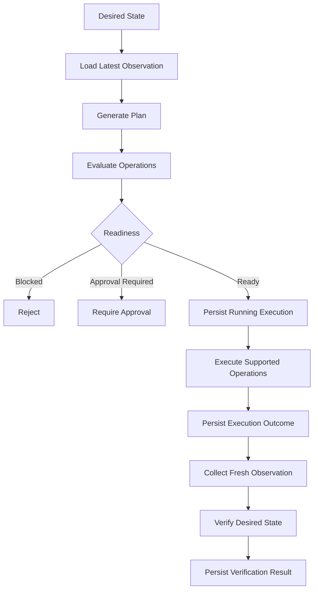

# Execution Lifecycle

This document describes how CloudPilot turns desired infrastructure state into evaluated operations, executes supported changes, persists execution outcomes, and verifies the resulting infrastructure.

The central design principle is that **planning, authorization, execution, and verification are separate stages**. A proposed change is not automatically an authorized change, and a successful provider request is not proof that the desired state was achieved.

## 1. Lifecycle at a glance

This is a conceptual view of the direct execution lifecycle. Reconciliation uses a related workflow with its own persisted run record, described later in this document.

## 2. Observation and desired state

CloudPilot works with two representations of infrastructure:

- **Observed state:** the infrastructure configuration retrieved from the provider.
- **Desired state:** the configuration that CloudPilot is being asked to maintain.

The inventory layer retrieves supported resources from Cloudflare. Completed observations are persisted so that planning and other control-plane operations can refer to a known snapshot.

An incomplete inventory operation does not replace the latest completed observation with a partial result. This preserves the distinction between a complete observation and an unsuccessful inspection attempt.

Desired-state input is validated before it is used by the control plane. The desired-state store currently represents a shared desired-state document rather than a per-user or per-tenant configuration.

## 3. Planning

The planning layer compares desired state with the latest saved observation and generates explicit operations.

An operation describes a requested resource change, such as:

- Create a resource.
- Update an existing resource.
- Delete a resource.

Planning also considers management scope. Resources outside the configured management scope are not treated as ordinary candidates for modification.

For existing Workers, planning checks deployed script content to detect script drift. This is important because a Worker can have configuration that appears unchanged while its deployed script differs from the intended version.

Planning produces a description of the changes required. It does not itself authorize or execute them.

## 4. Evaluation and readiness

Every planned operation is evaluated before execution.

Evaluation considers several independent dimensions:

| Dimension            | Question                                                            |
| -------------------- | ------------------------------------------------------------------- |
| Policy               | Is this operation permitted by the configured policy?               |
| Risk                 | What risk level is associated with this operation?                  |
| Approval             | Does the operation require approval?                                |
| Execution capability | Does the provider implementation support this operation?            |
| Readiness            | Can the operation proceed, or must it be blocked or approved first? |

### Policy

Policy evaluation determines whether an operation is allowed.

The current default policy denies Worker and Zone deletion. Other operations are evaluated according to the configured policy rules.

### Risk and approval

Risk evaluation classifies operations according to their potential impact.

Current examples include:

- Zone deletion: critical risk.
- DNS record deletion: high risk.
- DNS record update: medium risk.
- DNS record creation: low risk.
- Other operations without a more specific classification: medium risk.

High- and critical-risk operations require approval. A policy-denied operation does not become executable merely because an approval could be obtained.

The project currently evaluates approval requirements; it does not implement a complete human approval workflow.

### Provider capability

An operation can be permitted by policy and still be unsupported by the provider.

Current Cloudflare execution support is deliberately limited:

| Resource    | Inspection | Execution              |
| ----------- | ---------- | ---------------------- |
| Workers     | Supported  | Create, update, delete |
| Zones       | Supported  | Not supported          |
| DNS records | Supported  | Not supported          |

Unsupported operations are blocked before they reach the provider executor.

### Readiness outcomes

Evaluation classifies operations into readiness outcomes:

- `ready`: the operation is permitted and supported.
- `blocked`: policy or provider capability prevents execution.
- `approval_required`: the operation requires approval before it can proceed.

Readiness is an evaluation result, not an execution result.

## 5. Direct execution

The control plane exposes `POST /execute` for direct execution.

The endpoint does not blindly trust a previously generated proposal. It re-evaluates the desired-state workflow before executing operations.

The high-level flow is:

1. Load and validate the desired state.
2. Obtain the relevant observed state and generate a plan.
3. Evaluate the planned operations.
4. Reject blocked operations.
5. Reject operations that require approval but have not completed an approval workflow.
6. Persist an execution record with a running status.
7. Delegate supported operations to the provider execution layer.
8. Persist the terminal execution outcome and available summary.
9. Verify the resulting infrastructure state.

The endpoint uses distinct HTTP outcomes for important readiness failures:

| Condition                              | HTTP response |
| -------------------------------------- | ------------: |
| Policy-denied or unsupported operation |         `403` |
| Approval required                      |         `409` |
| Successful execution workflow          |         `200` |
| Execution failure                      |         `500` |

These responses describe the control-plane API behaviour; they should not be interpreted as a guarantee that every operation in a multi-operation plan succeeded.

### Operation-level execution

The plan executor handles operation dependencies.

Operations are ordered according to their dependency relationships. If an operation fails or is skipped, dependent operations are skipped rather than being executed against an invalid prerequisite state. Independent operations can continue.

Operation-level results distinguish:

- `succeeded`
- `failed`
- `skipped`

This is separate from the lifecycle status of the overall execution record.

## 6. Execution persistence

CloudPilot persists execution lifecycle records so that the control plane and dashboard can inspect what happened.

The lifecycle record uses statuses such as:

- `running`
- `succeeded`
- `failed`

Execution records can include summaries and verification information.

The control plane records the running state before provider execution and then attempts to persist a terminal outcome. When execution fails, the failure path attempts to preserve the available summary and verification information alongside the failed status.

Persistence is itself a failure boundary. If the database write fails, the control plane cannot guarantee that the intended lifecycle transition was durably recorded. A failure while attempting to persist a failure record can also prevent that record from being saved.

For this reason, a persisted execution status should be understood as the latest successfully stored lifecycle information—not an independent guarantee that every external side effect has been rolled back or that the provider state is unchanged.

## 7. Verification

CloudPilot does not treat a successful provider API response as proof of convergence.

After execution, the verification workflow obtains a fresh observation and compares the resulting configuration against desired state.

For Workers, verification also compares deployed script content. Worker scripts are handled separately from the ordinary observed-resource representation.

Verification outcomes include:

- `verified`: the checked configuration matches the desired state.
- `mismatch`: the observed configuration does not match the desired state.
- `failed`: verification could not be completed successfully.

A `verified` result means that the modeled configuration and checked Worker script content matched desired state at the time of verification.

It does **not** establish that:

- The application is healthy at runtime.
- Routes are functioning correctly.
- Bindings or triggers behave as intended.
- Requests are being served successfully.
- The deployed application meets business-level correctness requirements.

Verification is a configuration and deployment-state check, not an application health-monitoring system.

## 8. Reconciliation

Reconciliation coordinates the process of bringing observed infrastructure toward desired state.

The reconciliation workflow is related to direct execution, but it also persists a reconciliation-run record.

At a high level, it:

1. Creates a reconciliation run.
2. Loads desired state.
3. Obtains a fresh provider observation.
4. Compares observed and desired state.
5. Generates and evaluates a plan.
6. Stops if operations are blocked or require approval.
7. Executes permitted operations.
8. Verifies the resulting state.
9. Persists the terminal reconciliation outcome.

The API exposes this workflow through `POST /reconcile`.

Reconciliation therefore combines observation, planning, evaluation, execution, and verification into a coordinated operation. It is not simply a periodic provider sync.

### Concurrency and recovery

The persistence layer constrains concurrent active reconciliation runs so that multiple runs cannot independently proceed as active at the same time.

However, the current implementation does not provide a complete durable recovery protocol for abandoned runs. Leases, heartbeats, fencing, and automatic stale-run recovery are not implemented.

If a run remains marked as active after its process has terminated, recovery may require manual investigation. An operator should first establish that the original process is no longer running before attempting any manual recovery.

## 9. Failure boundaries

CloudPilot treats failures at different stages as distinct outcomes.

| Stage                    | Example failure                        | Expected consequence                                                               |
| ------------------------ | -------------------------------------- | ---------------------------------------------------------------------------------- |
| Observation              | Provider inspection fails              | No partial observation replaces the latest completed observation                   |
| Desired-state validation | Invalid document                       | Request is rejected before planning                                                |
| Evaluation               | Policy denies an operation             | Operation is blocked                                                               |
| Evaluation               | Provider does not support an operation | Operation is blocked                                                               |
| Evaluation               | Approval is required                   | Execution does not proceed                                                         |
| Execution                | Provider operation fails               | Operation and execution failure information is recorded where persistence succeeds |
| Persistence              | Database write fails                   | Durable lifecycle state may be incomplete                                          |
| Verification             | Fresh observation or comparison fails  | Verification is reported as failed                                                 |
| Reconciliation           | Run is abandoned                       | The run may remain active and require manual investigation                         |

A failure in one stage does not imply that previous stages have been rolled back. In particular, a provider-side change may have occurred even if a subsequent persistence operation fails.

## 10. Related API endpoints

The following control-plane endpoints participate in or expose the lifecycle:

| Endpoint                 | Purpose                                             |
| ------------------------ | --------------------------------------------------- |
| `GET /inspect`           | Inspect supported infrastructure                    |
| `GET /state`             | Retrieve saved observed state                       |
| `GET /desired-state`     | Retrieve desired state                              |
| `PUT /desired-state`     | Validate and save desired state                     |
| `POST /plan`             | Generate a plan from desired and observed state     |
| `POST /evaluate`         | Evaluate proposed operations without executing them |
| `POST /execute`          | Execute permitted, supported operations             |
| `POST /verify`           | Verify infrastructure against desired state         |
| `POST /reconcile`        | Coordinate the reconciliation workflow              |
| `GET /executions/latest` | Retrieve the latest execution record                |
| `GET /executions/:id`    | Retrieve a specific execution record                |

The control-plane API uses a bearer-token authentication boundary. The MCP interface has a separate authentication boundary.

## 11. Implementation boundaries

The lifecycle described here reflects the current implementation, not a claim of complete production readiness.

Important boundaries include:

- Cloudflare is the currently implemented provider.
- Worker create, update, and delete are the supported execution operations.
- Zone and DNS record mutations are not supported.
- Approval requirements are evaluated, but a complete human approval lifecycle is not implemented.
- Verification covers modeled configuration and checked Worker script content, not runtime health.
- D1 adapter tests use mocks and do not establish full integration correctness against a live D1 database.
- Durable stale reconciliation-run recovery is not implemented.
- Execution and reconciliation persistence failures can leave incomplete lifecycle records.

---

**Related documentation:** [README](../README.md)
